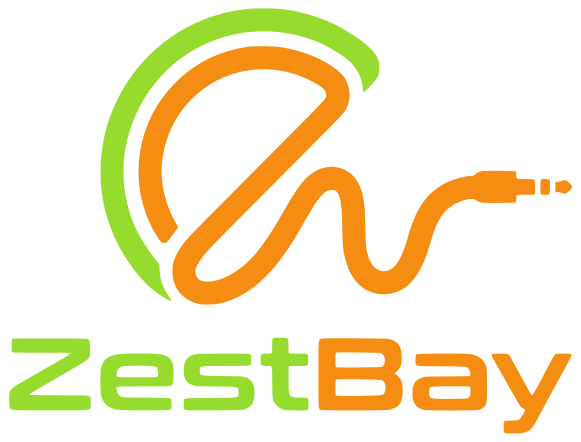
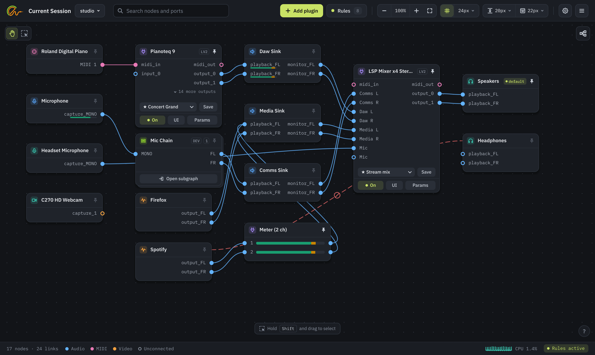
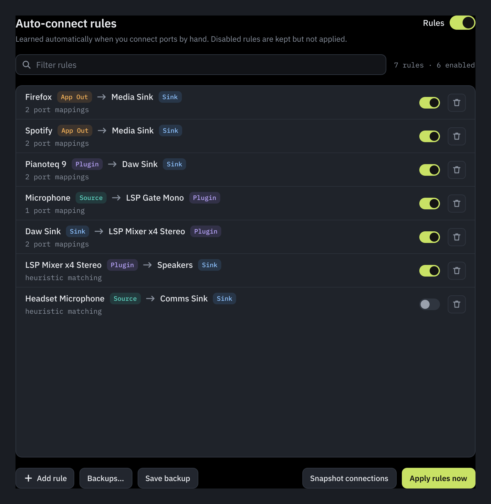
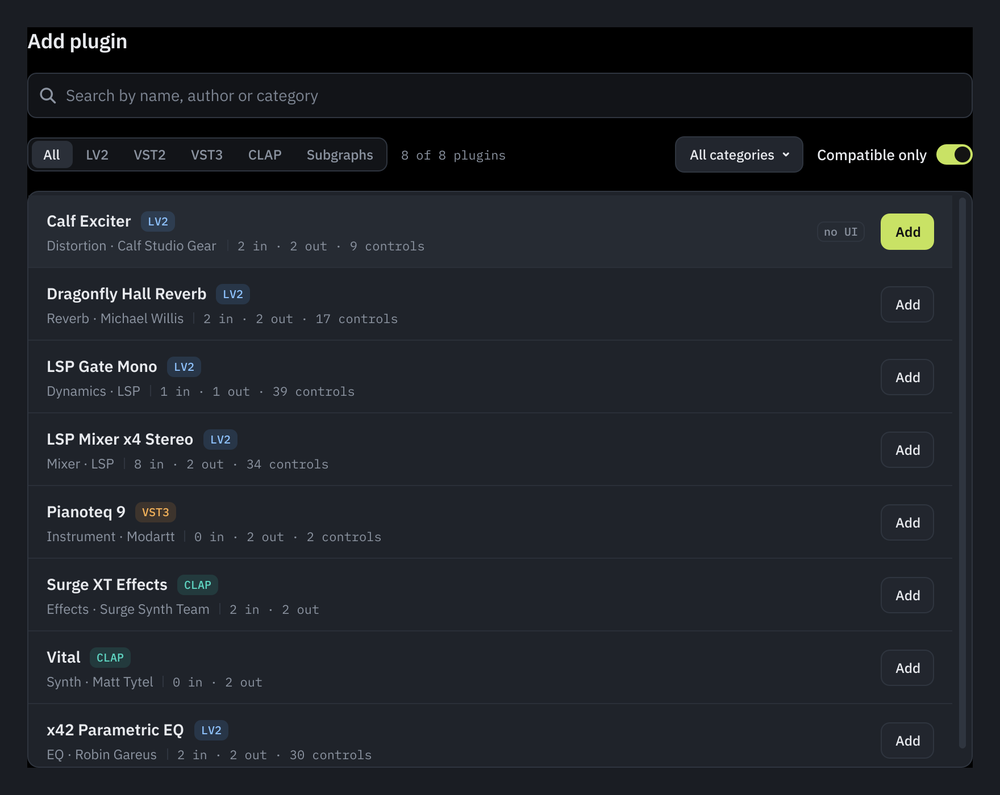
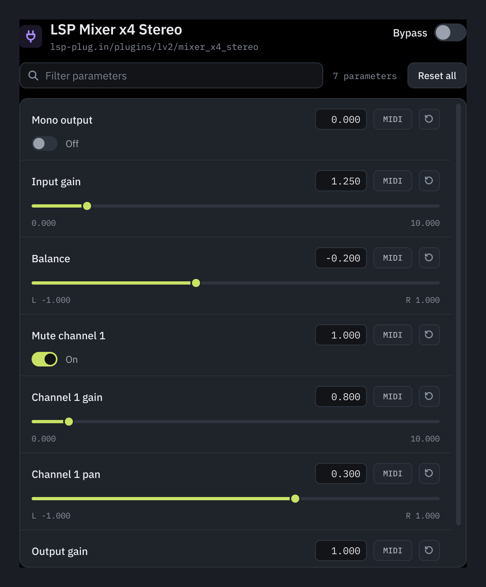
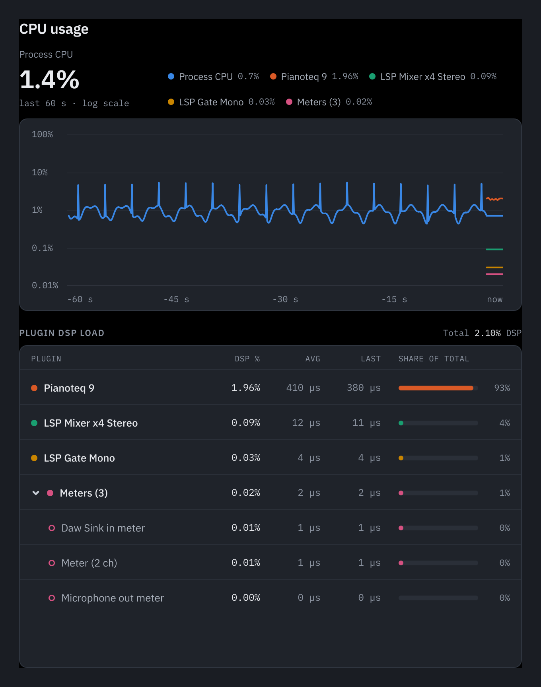
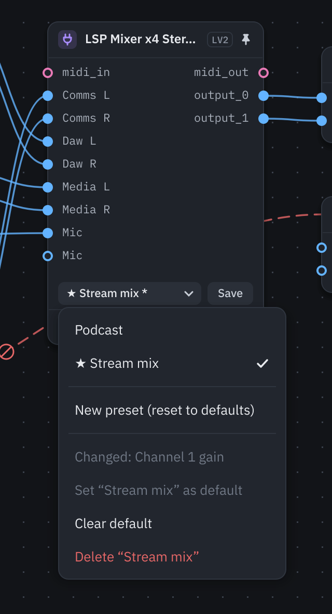
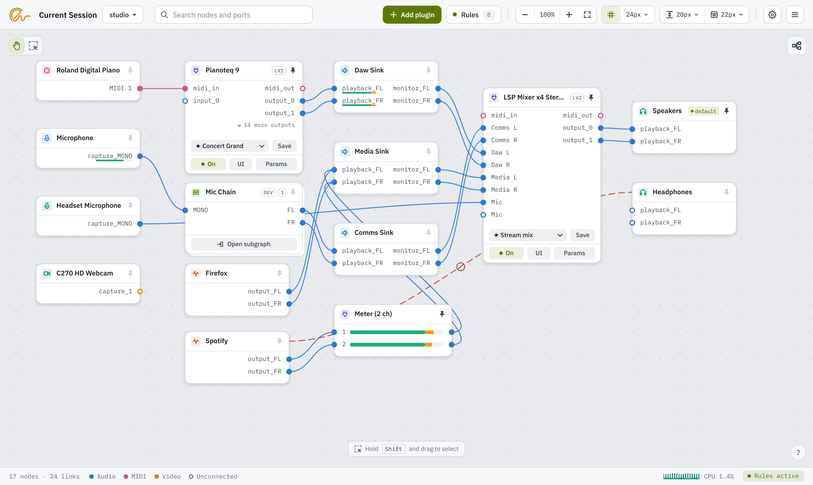

# ZestBay

<p align="center">
  
</p>

<p align="center">
  <strong>A PipeWire patchbay and audio routing manager with integrated LV2, LADSPA, VST2, VST3, and CLAP plugin hosting.</strong>
</p>

<p align="center">
  Built with Rust + Qt6/QML for a fast, native Linux desktop experience.
</p>

<p align="center">
  <a href="https://lemonxah.github.io/zestbay/"><strong>Website</strong></a>
  &middot; <a href="#installation">Install</a>
  &middot; <a href="https://github.com/lemonxah/zestbay/releases/latest">Releases</a>
</p>

---

## What is ZestBay?

ZestBay is a visual audio routing tool for PipeWire on Linux. It lets you see every audio node in your system (applications, hardware devices, virtual sinks), connect and disconnect ports with drag-and-drop, host LV2, LADSPA, VST2, VST3, and CLAP effects plugins inline, define patchbay rules that automatically restore your routing (or keep things apart) whenever devices or apps appear, group plugin chains into reusable subgraphs, and create virtual devices.

## Screenshots

<p align="center">
  
</p>

<table>
  <tr>
    <td></td>
    <td></td>
  </tr>
  <tr>
    <td></td>
    <td></td>
  </tr>
  <tr>
    <td></td>
    <td valign="top"><strong>Plugin presets</strong><br>Every plugin node has a preset dropdown and a Save button. Save a plugin's settings once, then pick them on any other instance, or make one the default so new instances start from it. See <a href="#plugin-presets">Plugin Presets</a>.</td>
  </tr>
</table>

<p align="center">
  
</p>

<sub>Screenshots are rendered from the real UI with sample data by
<code>design/screenshots/render.sh</code>.</sub>

## How it differs from other tools

### vs. qpwgraph

qpwgraph is a straightforward PipeWire graph editor. ZestBay goes further:

- **LV2, LADSPA, VST2, VST3, and CLAP plugin hosting** -- Insert effects (EQ, compressor, reverb, etc.) directly into the PipeWire graph without needing a DAW or separate plugin host. ZestBay creates real PipeWire filter nodes with RT-safe DSP processing. Comprehensive LV2 extension support (URID, worker, state, log, options, buf-size, data-access, instance-access) means most LV2 plugins load without issues. VST2, VST3, and CLAP plugins are hosted with parameter, state, and native UI support. LADSPA plugins are hosted with parameters and bypass (the format has no UI or state API).
- **Native plugin UIs** -- Open the original plugin interfaces. LV2 UIs (GTK3, X11, Qt5, GTK2, GTK4) via suil, VST2, VST3, and CLAP UIs via embedded X11 windows. A persistent GTK thread manages LV2 plugin windows without the crash-on-reopen issues common in LV2 hosts.
- **Plugin presets** -- Save a plugin's settings as named presets, pick them from a dropdown on the plugin node, and apply them to any other instance of that plugin instead of re-entering every value. One preset per plugin can be the default, so new instances start from it. For LV2 plugins a preset also keeps the plugin's saved state (for example the LSP Mixer's channel names), not just the knob positions. See [Plugin Presets](#plugin-presets).
- **MIDI parameter control** -- Map hardware MIDI controllers to any plugin parameter with one-click learn. Continuous, toggle, and momentary modes with RT-safe processing.
- **Crash-safe plugin loading** -- Every plugin is test-loaded in a separate process before it runs inside ZestBay, plugin discovery runs in the background so startup isn't held up, and if a restore still crashes the next start enters safe mode and offers the last known-good plugin set.
- **Per-plugin CPU load** -- A CPU usage window shows each plugin's DSP load over time, so you can see which effect is costing you.
- **Quick wiring** -- Drag a plugin onto a wire to insert it into that connection, and set a default node so app streams without a rule are routed there.
- **Auto-connect rules with learning and blocking** -- Manually connect two ports and ZestBay creates a patchbay rule; disconnect them and the rule updates. Block rules keep a source from ever reaching a target.
- **Subgraphs and virtual devices** -- Group a plugin chain into one block, reuse it as a template, offer it to apps as a microphone or speaker, and create virtual sinks and sources without editing PipeWire config.
- **Full session persistence** -- Plugin instances, their parameters and state, bypass, wiring, MIDI mappings, subgraphs, virtual devices, layout, pins, viewport, window geometry, hidden nodes and rules all survive restarts.
- **System tray with start-minimized** -- Run ZestBay as a background service. It starts hidden, keeps your routing rules active, and shows the window when you click the tray icon.

### vs. Carla

Carla is a full-featured plugin host and JACK patchbay. The differences are about scope and integration:

- **PipeWire-native** -- ZestBay connects directly to PipeWire's native API, not through the JACK compatibility layer. Every PipeWire node (app streams, hardware devices, virtual sinks) appears naturally in the graph.
- **Lightweight and focused** -- ZestBay is a patchbay first. There is no transport, no MIDI sequencing, no rack view. It hosts LV2, LADSPA, VST2, VST3, and CLAP plugins for inline effects processing with MIDI CC/note learn for hands-on parameter control from hardware controllers. If you need a full DAW-style plugin host environment with MIDI tracks and transport, use Carla. If you need persistent audio routing with inline effects and hardware knob control, ZestBay is simpler and faster to set up.
- **Presets live on the node** -- Carla keeps plugin settings in its project files. In ZestBay your session is saved automatically, and each plugin node also has its own named presets next to its On / UI / Params buttons. They are stored once per plugin and shared by every instance of it, with an optional default for new instances, so setting up the fifth copy of a mixer or EQ is one click instead of re-entering its values.
- **Hands-on recovery** -- A **Restart PipeWire** item in the menu restarts PipeWire, PipeWire-Pulse and WirePlumber when a device drops out or something wedges. ZestBay reconnects and restores its plugins and links by itself.
- **No runtime dependencies beyond Qt6, PipeWire and the LV2 libraries** -- No Python. ZestBay ships its main binary and a small `zestbay-ui-bridge` helper that can run LV2 plugin UIs in a separate process.
- **Rust** -- Memory-safe core with lock-free DSP-to-UI communication. The RT audio callback uses raw pointers only where PipeWire's filter API requires it.

### vs. Helvum, PatchMatrix, and other GTK patchbays

- **LV2, VST2, VST3, and CLAP plugin hosting** -- Most PipeWire patchbays only visualize and connect. ZestBay can host plugins from all five plugin formats inline.
- **Plugin presets, MIDI control and per-plugin CPU load** -- These only make sense once plugins are hosted: save and reuse a plugin's settings across instances (with an optional default for new ones), drive parameters from a hardware controller, and see what each plugin costs. See [Plugin Presets](#plugin-presets) and [MIDI Parameter Control](#midi-parameter-control).
- **Subgraphs and virtual devices** -- Group a plugin chain into one reusable block, offer it to apps as a microphone or speaker, and create virtual sinks and sources from the UI.
- **Auto-connect and block rules** -- Define patterns that automatically wire things up when nodes appear, or keep them apart. Other tools require manual reconnection every time.
- **Qt6/QML** -- Native look and feel on KDE Plasma and other Qt-based desktops, with dark and light themes that follow the desktop.

## Features

### Graph View

**The graph**
- Real-time PipeWire graph: devices, app streams, virtual sinks, plugins and subgraphs as node cards, colour-coded by kind; wires coloured by signal (audio, MIDI, video)
- MIDI bridge devices split into one node per device
- Plugins with many unused ports fold them into a "n more" row
- The node under the cursor is highlighted, and a node whose name is too long for its card shows the full name in a popup
- **Search** nodes and ports (Ctrl+F); non-matching nodes dim
- Status bar with node/link counts, a CPU sparkline and the rules state; dark and light themes, or follow the desktop
- **Hide unnamed nodes** (Preferences › Advanced, on by default) leaves out nodes with no name of their own, such as pavucontrol's level-meter streams

**Moving around**
- Zoom with the wheel (0.25x-3.0x; pinch on a touchpad or touchscreen works too), scroll bars, Fit to view (Home), Frame selection (F) and Reset zoom
- **Grab / Select mode** (buttons at the canvas's top-left, or **W**): in Grab mode (the default) a left-drag on empty canvas pans, like a middle-drag; in Select mode it draws a selection box. The choice is remembered
- **Hold a key for the other mode**: hold **Space** and drag to pan from anywhere, even over a node; hold **Shift** and drag empty canvas to draw a selection box while in Grab mode. A hint at the bottom of the canvas names the key and lights up while the override is on
- A **?** button at the bottom-right of the canvas, **?** and **F1** open a list of every shortcut (also in the menu: Keyboard shortcuts…)

**Wiring**
- Drag from a port to another port to connect. Wires highlight and can be clicked from a few pixels away, so you don't have to hit them exactly
- Right-drag from one port to another to **block** the pair; blocked pairs are drawn as red dashed lines with a ⊘. Hover one to highlight it, click it to select it (Ctrl+click to add more) and press **Delete** to remove the rule that blocks it. A rule can cover several pairs; the toast says when removing it frees others too
- Drag a plugin onto a wire to insert it into that connection
- **Default node**: right-click a sink or plugin → Set as default; app streams without a rule are routed there

**Selecting and editing**
- Select nodes and wires with a click, Ctrl+click or a selection box; boxes started with **Shift** or **Ctrl** add to the selection, **Ctrl+A** selects all nodes and wires. Neither a box nor Ctrl+A takes block lines, so Delete can't remove a rule by accident
- **Delete** disconnects the selected wires, removes the selected plugins, subgraphs and virtual devices (after a confirmation), hides the selected devices and app streams, and removes the selected block rules
- Arrow keys nudge the selected nodes one grid step
- **Undo / redo** (Ctrl+Z, Ctrl+Shift+Z) for node moves, Auto layout, wires you connect or disconnect, and hidden nodes
- Drag nodes, alone or as a group; **snap to grid** (on by default, adjustable grid size) or Shift-drag to snap next to other nodes with a configurable gap
- **Pin** nodes so Auto layout never moves them; hide and unhide nodes
- Right-click menus for nodes, wires, block lines, ports and the canvas; right-click a port's name or pin to **rename** it or **disconnect** everything on it (see [Renaming nodes and ports](#renaming-nodes-and-ports))

**Layout and density**
- **Auto layout** follows the signal flow (and the grid): the button at the canvas's top-right, **L**, or the canvas menu. Pinned nodes stay put and the toast tells you how many did; **Shift+click / Shift+L** lays out pinned nodes too, and when every node is pinned it offers to do so
- **New nodes find a tidy spot**: a stream that a rule connects goes beside the node it is wired to, stacked with the others in that column; a node without wires goes with its own kind (sources left, sinks right) inside the part of the graph you are looking at. Only the newcomer moves, and only in its first seconds; anything you placed or pinned stays put. A new node pulses once, and if it appeared outside the view a marker at the edge points to it (click to go there)
- **Two densities** (toolbar, or Preferences › Graph), each Compact / Normal / Spacious or any pixel value:
  - **Graph density** (node spacing, 4–96 px): how far apart nodes are. It sets the room Auto layout and newly placed nodes leave around each node.
  - **Card density** (card row height, 16–32 px): how big the node cards are. Compact packs more nodes on screen, Spacious makes ports easier to hit; text sizes stay. Cards that end up overlapping are pushed apart (Ctrl+Z undoes it).

  The toolbar menus can re-space the whole graph with Auto layout.

### Plugin Hosting (LV2, LADSPA, VST2, VST3, CLAP)
- Browse, search, and filter all installed plugins by name, author, category, format or URI/ID; hide incompatible ones
- **Faster startup**: saved plugins can restore without waiting for discovery, while plugin scanning runs in the background with up to four isolated scan processes at a time for VST2, VST3, and CLAP
- One-click instantiation as real PipeWire filter nodes with RT-safe audio processing
- 25 recognized plugin categories (Compressor, EQ, Reverb, Delay, etc.)
- Parameters window: sliders and toggles, per-parameter reset, MIDI learn
- **Manage plugins** window: every active plugin with its parameters, bypass state and Reset params
- Native plugin UI support:
  - **LV2**: GTK3, X11, Qt5, GTK2, GTK4 via suil; UIs that don't need direct access to the plugin instance can run in the separate `zestbay-ui-bridge` process
  - **VST2**: Embedded X11 editors with idle callbacks and resize support
  - **VST3**: Embedded X11 windows with IPlugFrame resize support
  - **CLAP**: Embedded X11 windows with GUI resize and timer support
- Multiple simultaneous native plugin UIs
- Bypass toggle per plugin instance; rename plugins and their ports (see [Renaming nodes and ports](#renaming-nodes-and-ports))
- Plugin state (parameters, bypass, LV2 state, VST2/VST3/CLAP state, connections) persisted across sessions
- **Persistent LSP input names**: rename channels in an LSP Mixer LV2 editor and the names appear on the corresponding node input ports within about a second. Names are saved with the plugin state and restored after restarting ZestBay. Stereo channels show L/R suffixes; routing keeps its stable port identifiers.
- **Crash protection**: each plugin is test-loaded in a separate process before it runs in ZestBay, so a crashing plugin is skipped instead of taking the app down. If a restore still crashes, the next start enters safe mode and offers the last known-good plugin set
- **Presets** per plugin: save a plugin's settings once and reuse them on any other instance (see [Plugin Presets](#plugin-presets))
- **CPU usage** window: per-plugin DSP load over time
- Optional "Let idle devices sleep" (passive effects) so a device linked only through plugins can suspend

### Renaming nodes and ports

**Nodes.** Right-click a plugin → **Rename…** (a subgraph: **Rename / edit…**; a virtual device: **Edit virtual device…**). The dialog opens with the name selected, so just type the new one. The name is saved, shows in the graph, in the **CPU usage** window and in the tray, and the plugin's saved links follow it.

**Ports of plugins.** Right-click a port's **name** (or its pin, without dragging) on a plugin node → **Rename port…**. An empty name restores the original. Renamed ports keep their place in the list, and links are unaffected. Port names are saved with the plugin in `plugins.json`, so they come back after a restart, and they can be saved with a preset:
- Saving a preset also saves the plugin's port names. Applying a preset that has names sets them; a preset saved without any (including every preset from before this feature) leaves your names alone.
- A preset shows the modified `*` marker when its saved port names differ from the plugin's.
- **Ctrl+S** writes every plugin's current settings, port names included, back into the preset it has selected, for the plugins that differ from it. Plugins with no preset selected are skipped; nothing new is created.

Only plugin ports can be renamed (device and stream ports are named by their owners). The same port menu has **Disconnect**, which removes every link on that port; right-dragging from a pin still draws a block wire.

### Plugin Presets

A preset is a named snapshot of one plugin's settings. Set a plugin up once, save it as a preset, and from then on every other instance of that plugin, in this session or a later one, can get the same settings from the dropdown instead of you dialing every value in again. Typical uses: several LSP mixers or compressors that should start the same, a favourite EQ curve, or a few alternative setups of one plugin to switch between.

Every plugin node has a preset row above the **On / UI / Params** buttons: a dropdown showing the selected preset, and a **Save** button.

**Using presets**
1. Set the plugin up the way you want it (in its own window or in **Params**).
2. Press **Save**, type a name, and press **Save as new preset**. The new preset is now selected on that node.
3. Add another instance of the plugin (or open a different one) and pick the preset from its dropdown. All the values are applied at once.

**The dropdown**
- Pick a preset from the list to apply it to this plugin. The selected one is checked.
- **New preset (reset to defaults)** puts the plugin back to the plugin's own defaults, including its saved state, and deselects the preset. Set it up again and press **Save** to make a new one.
- **Set "name" as default** makes the selected preset the plugin's default: a new instance of that plugin starts from it right away (marked with a `★` in the list). **Clear default** undoes that. Plugins restored when ZestBay starts keep their own saved settings, not the default.
- **Delete "name"** removes the selected preset.

**Saving**
- Typing a new name in **Save** creates a new preset. Typing the name of an existing preset replaces it (the button then reads **Replace preset**).
- When a preset is selected, **Update "name" with the current settings** in the Save dialog overwrites it directly.
- A `*` after the preset name means the plugin's settings no longer match the preset, because you changed a value or moved a mapped MIDI control. Open the dropdown to see what changed (a greyed-out "Changed: ..." line). Save to update the preset, or pick it again to go back to it.

**What a preset contains**
- All the plugin's parameter values.
- For LV2 plugins, the plugin's saved state too, which is where things that aren't ordinary parameters live, such as the **LSP Mixer's channel names**. Applying a preset with state re-creates the plugin in place (same name, same links), with a brief audio gap. Files the plugin keeps for its state (written through the LV2 state path features) are copied into the preset and into the target instance when the preset is applied. Those per-instance state folders under `~/.config/zestbay/plugin-state/` are not deleted when a plugin is removed.
- CLAP, VST3 and VST2 presets hold parameter values only.
- Presets also hold the plugin's [port names](#renaming-nodes-and-ports).

Presets are kept per plugin, so a preset made for one plugin never shows up on another, and every instance of that plugin shares the same list. They are stored in `~/.config/zestbay/presets.json` (under `~/.var/app/io.github.lemonxah.ZestBay/config/zestbay/` for the Flatpak). To use your presets on another machine, copy that file.

### MIDI Parameter Control
- Map any MIDI CC or note message to any plugin parameter across all plugin formats (LV2, LADSPA, VST2, VST3, CLAP)
- **MIDI Learn**: click Learn on a parameter, move a knob or press a key on your controller, done
- Three mapping modes:
  - **Continuous**: CC 0-127 mapped linearly (or logarithmically for log-scale parameters) to the parameter range
  - **Toggle**: each press (CC > 63) flips the parameter between min and max
  - **Momentary**: parameter follows the controller state (on while held, off when released)
- Per-device mappings: bind different parameters to different MIDI controllers simultaneously
- Channel-specific or any-channel matching
- **MIDI mappings** window listing every mapping; conflicts are detected and can be reassigned
- RT-safe processing: MIDI is parsed and applied to parameter atomics directly in the PipeWire audio callback with no locks on the audio path
- Mappings persisted across sessions; mappings for an unplugged controller wait until it returns

### Supported LV2 Extensions
ZestBay provides a comprehensive set of LV2 host features, allowing it to load the vast majority of LV2 plugins:

| Extension | URI | Description |
|-----------|-----|-------------|
| URID Map | `http://lv2plug.in/ns/ext/urid#map` | Map URIs to integer IDs for RT-safe use |
| URID Unmap | `http://lv2plug.in/ns/ext/urid#unmap` | Reverse-map integer IDs back to URI strings |
| Worker | `http://lv2plug.in/ns/ext/worker#schedule` | Non-RT worker thread for heavy operations (file I/O, allocation) |
| State | `http://lv2plug.in/ns/ext/state#makePath` | Plugin state save and restore |
| Log | `http://lv2plug.in/ns/ext/log#log` | Structured logging with LV2 log levels routed to the host log system |
| Options | `http://lv2plug.in/ns/ext/options#options` | Expose host options (block length, sequence size, sample rate) to plugins |
| Buf-Size | `http://lv2plug.in/ns/ext/buf-size#boundedBlockLength` | Advertise bounded and fixed block length capabilities |
| Data Access | `http://lv2plug.in/ns/ext/data-access` | Provide plugin extension data to UIs |
| Instance Access | `http://lv2plug.in/ns/ext/instance-access` | Provide direct plugin instance handle to UIs |
| Resize Port | `http://lv2plug.in/ns/ext/resize-port#resize` | Port buffer resize requests (stub -- returns ERR_NO_SPACE) |
| URI Map | `http://lv2plug.in/ns/ext/uri-map` | Deprecated URI mapping for legacy plugin compatibility |

### Patchbay Rules
- **Auto-learn**: connect ports by hand and a rule is created; disconnect them and the rule is updated (can be turned off)
- Glob pattern matching for source and target node names (`*`, `?`), optionally limited to a node type
- Per-port-pair mappings with heuristic fallback (channel name, position)
- **Exclusive mode**: a source with rules is kept to exactly the connections its rules allow; turned off, rules only add links and never remove any
- **Block rules**: right-click a wire → Block this connection, select wires → Block selected links, or right-drag from one port to another. A blocked source never reaches the target: not by rules, the default node or by hand. Blocked pairs are drawn as red ⊘ lines; hover one to highlight it, click it to select it and press Delete (or right-click it → Remove block) to remove the rule
- Rules dialog: filter, enable/disable or delete each rule, add connect or block rules with quick-fill from existing node names
- **Backups**: save named backups of the rule set and restore them
- Snapshot current connections as a complete rule set
- Configurable settle time before rules are applied after graph changes
- Rules on/off and Exclusive mode from the menu and the tray; Apply rules now from the menu

### Subgraphs and Virtual Devices
- **Group** plugins into a subgraph (select them → right-click → Group into subgraph…) with a chosen number of inputs and outputs and optional MIDI; wires from outside are rerouted through it without dropping audio, and rules move with them
- **Open** a subgraph (button on its card, or double-click) to edit the plugins between its Input and Output nodes; Graph or Escape goes back
- **Edit** name, channels, MIDI and device options; **Ungroup** to turn it back into plain plugins; **Delete** removes it with its plugins
- **Show as a device**: the subgraph's input can be an output device apps play into, its output an input device apps record from (e.g. a "Mic Chain" microphone you pick in Discord)
- **Templates**: save a subgraph (plugins, settings, wiring, layout) and insert it again from Add plugin › Subgraphs, or Duplicate it
- **Virtual devices**: create virtual sinks and sources (like "Comms Sink") from the canvas menu instead of PipeWire config; edit or remove them from their node menu. They exist while ZestBay runs; a name another device already uses is skipped

### Sessions

A session is one complete setup: its plugins (with state, presets selection and port names), links, patchbay rules, subgraphs, virtual devices, MIDI mappings, node layout, pins, hidden nodes, default node and view. Keep several (for example "studio", "live" and "streaming") and switch between them without restarting.

- **Pick one** from the dropdown in the toolbar, between the ZestBay name and the search field. **New session…** creates an empty one and switches to it. The dustbin on a row deletes that session after a confirmation; the open session can't be deleted. Preferences › Session has the same list with switch and delete buttons.
- **Switching is live.** ZestBay saves the open session, stops its plugins and virtual devices, then loads the other one the way startup does. Audio through ZestBay's plugins stops for a few seconds. It refuses while ZestBay is still starting up. The new session's patchbay rules apply as soon as it opens, so with **Exclusive mode** on, links the new rules don't allow are removed.
- **Open one from the command line** (for that run only; it doesn't change which session opens by default):

  ```sh
  zestbay --session studio                 # ~/.config/zestbay/sessions/studio/, created if missing
  zestbay --session_path /path/to/folder   # use any folder as the session
  ```

  Without either, ZestBay opens the one you last switched to (remembered in `current_session`), otherwise `default`.
- **Where they live:** one folder per session in `~/.config/zestbay/sessions/<name>/`, so the list of sessions is the list of folders and you can copy, back up or share one with a file manager. Names are plain folder names: no slashes, not starting with a dot.
- **Shared by every session:** preferences, window size, OSC settings, **presets** (`presets.json` and its files) and the subgraph templates.
- **First run after updating:** your existing files are copied into the `default` session. The old files stay where they were.
- **Over OSC:** `/zestbay/session/load "name"` switches session, `/zestbay/sessions` lists them (see below).

### OSC Remote Control

Control plugins from another program or device (TouchOSC, a script, `oscsend`, a stage controller) over UDP. Links are not controllable by design.

Turn it on in **Preferences › Remote control (OSC)**:
- **Enable OSC**: off by default; takes effect immediately.
- **UDP port**: 9000 by default (1024-65535).
- **Accept from other devices**: off by default, so only programs on this computer can reach it. There is no password; turn it on only on a network you trust.

**Naming.** `<plugin>` is the plugin's name as shown in ZestBay, in lowercase with every run of other characters turned into `_`: "Reverb 1" is `reverb_1`, "LSP Compressor (stereo)" is `lsp_compressor_stereo`. The plugin's stable id also works. `<param>` is the parameter's symbol, its name in the same lowercase form, or its port index. Ask ZestBay for the exact names with the query messages below.

| Address | Arguments | Effect |
|---------|-----------|--------|
| `/zestbay/plugin/<plugin>/enable` | `1` / `0` (none = on) | Turn the plugin on or off (off = bypassed) |
| `/zestbay/plugin/<plugin>/bypass` | `1` / `0` (none = bypassed) | The reverse of `enable` |
| `/zestbay/plugin/<plugin>/toggle` | none, or `1` | Flip on/off. A `0` is ignored, so a button that sends 1 on press and 0 on release toggles once |
| `/zestbay/plugin/<plugin>/param/<param>` | number | Set the parameter in its own range; clamped to its minimum and maximum |
| `/zestbay/plugin/<plugin>/param/<param>/normalized` | number 0.0-1.0 | Set the parameter as a fraction of its range |
| `/zestbay/plugin/<plugin>/preset` | string | Apply a saved preset by exact name (same as picking it in the UI, including saved state and port names) |
| `/zestbay/session/load` | string | Switch to another session, live |
| `/zestbay/plugins` | none | Query: list the plugins |
| `/zestbay/plugin/<plugin>/params` | none | Query: list the plugin's parameters |
| `/zestbay/sessions` | none | Query: list the sessions |

Numbers can be sent as float, int, double or boolean. Bundles are accepted.

**Replies.** Queries are answered to the address and port the request came from:
- `/zestbay/plugin <plugin> <name> <enabled 0|1>`, one message per plugin
- `/zestbay/param <plugin> <symbol> <name> <value> <min> <max>`, one per parameter
- `/zestbay/session <name> <open 0|1>`, one per session
- `/zestbay/error <message>` when `/zestbay/session/load` fails (unknown session, already open, still starting up)

**Examples** (with `oscsend` from liblo):

```sh
oscsend localhost 9000 /zestbay/plugin/reverb_1/enable i 0            # switch the reverb off
oscsend localhost 9000 /zestbay/plugin/comp/param/threshold f -18.0  # set a value
oscsend localhost 9000 /zestbay/plugin/comp/param/threshold/normalized f 0.5
oscsend localhost 9000 /zestbay/plugin/comp/preset s "Vocal"
oscsend localhost 9000 /zestbay/session/load s "live"
```

**Good to know.** Messages are applied on ZestBay's UI timer (100 ms by default; Preferences › Timing, minimum 16 ms), and a parameter sent repeatedly within one tick only counts once, so a fast fader doesn't pile up. Parameter changes are saved like changes made in the UI. While a session switch is in progress other messages are ignored.

### System Tray
- Start minimized (background service mode) and close to tray
- Left-click the tray icon to show or hide the window
- Tray menu: Show/Hide ZestBay, Plugin UIs (open any plugin's UI), Add plugin…, Patchbay rules…, Rules enabled and Exclusive mode toggles, Preferences…, Quit

### Keyboard Shortcuts

Press **?** or **F1** (or use the **?** button at the canvas's bottom-right, or the menu) for this list inside ZestBay.

**Move around**

| Key | Action |
|-----|--------|
| Wheel | Zoom around the cursor |
| Middle-drag | Pan |
| Left-drag on empty canvas | Pan in Grab mode, draw a selection box in Select mode |
| W | Switch between Grab and Select mode |
| Space (hold) | Pan with a left-drag from anywhere, in either mode |
| Shift (hold, on empty canvas) | Draw a selection box in Grab mode |
| Home | Fit the graph to the view |
| F | Frame the selected nodes (everything when nothing is selected) |
| Ctrl+= / Ctrl+- / Ctrl+0 | Zoom in / zoom out / reset zoom |

**Select**

| Key | Action |
|-----|--------|
| Click | Select a node, a wire or a block line |
| Ctrl+Click | Add to or remove from the selection |
| Shift or Ctrl (while drawing a selection box) | Add to the selection |
| Ctrl+A | Select all nodes and wires (not block rules) |
| Escape | Cancel a drag or placement, clear the selection, then leave a subgraph |

**Connect and edit**

| Key | Action |
|-----|--------|
| Drag from a port | Connect to another port |
| Right-drag from a port | Block the pair (a red line) |
| Delete / Backspace | Disconnect the selected wires; remove the selected plugins, subgraphs and virtual devices (asks first); hide the other selected nodes; remove the selected block rules |
| Arrow keys | Move the selected nodes one grid step (1 px without snap to grid, 10 px with Shift) |
| Shift (while dragging a node) | Snap to nearby nodes (when snap to grid is off) |
| Ctrl+Z / Ctrl+Shift+Z (or Ctrl+Y) | Undo / redo node moves, Auto layout, connecting and disconnecting wires, hiding nodes |
| Double-click | Open a subgraph |

**Layout and application**

| Key | Action |
|-----|--------|
| L | Auto layout (pinned nodes stay put) |
| Shift+L | Auto layout including pinned nodes |
| Ctrl+F | Search nodes and ports |
| Ctrl+S | Save every modified plugin's settings into its selected preset |
| F1 or ? | Show the shortcut list |
| Ctrl+Q | Quit |

### Persistence
Everything is saved to `~/.config/zestbay/` (`~/.var/app/io.github.lemonxah.ZestBay/config/zestbay/` for the Flatpak) as JSON. Settings and libraries sit in that folder; each [session](#sessions) has its own folder under `sessions/<name>/` with everything that makes up a setup.

**Shared by every session** (`~/.config/zestbay/`):

| File | Contents |
|------|----------|
| `preferences.json` | All user settings, including OSC |
| `window.json` | Window position and size |
| `presets.json`, `preset-files/` | Plugin presets (with port names) and the state files they hold |
| `subgraph_templates/` | Saved subgraph templates |
| `current_session` | The session that opens by default |

**Per session** (`~/.config/zestbay/sessions/<name>/`):

| File | Contents |
|------|----------|
| `plugins.json` | Active plugin instances (LV2, LADSPA, VST2, VST3, CLAP) with parameters, state and port names, including custom LSP Mixer input names |
| `plugins.known_good.json` | Last plugin set that loaded cleanly (crash recovery) |
| `plugin-state/` | State files plugins keep per instance |
| `links.json` | Connections of plugins, subgraphs and virtual devices |
| `rules.json`, `rule_backups/` | Patchbay connect and block rules, and their backups |
| `subgraphs.json` | Subgraphs: settings, member plugins, view |
| `virtual_devices.json` | Virtual sinks and sources |
| `midi_mappings.json` | MIDI CC/note-to-parameter mappings |
| `layout.json` | Node positions in the graph view |
| `pinned.json`, `hidden.json` | Pinned and hidden nodes |
| `default_node.txt` | The default node for unruled app streams |
| `viewport.json` | Pan and zoom state |

Subgraph and virtual device files from older versions are upgraded when ZestBay starts (the original is kept as `<file>.pre-upgrade`); a config file that can't be read is kept as `<file>.corrupt-<date>` and reported.

## Installation

The [official website](https://lemonxah.github.io/zestbay/) has the same install steps with a short overview of the features.

### Ubuntu (PPA)

ZestBay is available from a Launchpad PPA for Ubuntu 24.04 LTS and 26.04 LTS
(and derivatives such as Linux Mint and Pop!_OS). Launchpad builds it against
each release's own libraries, so it installs cleanly on both.

```bash
sudo add-apt-repository ppa:lemonxah/tools
sudo apt update
sudo apt install zestbay
```

Updates then arrive through the normal `apt upgrade`. To remove it:
`sudo apt remove zestbay && sudo add-apt-repository --remove ppa:lemonxah/tools`.

PPA page: <https://launchpad.net/~lemonxah/+archive/ubuntu/tools>

### Debian

Download the `.deb` for your release from the
[latest release](https://github.com/lemonxah/zestbay/releases/latest)
(`zestbay_<version>-debian12_amd64.deb` for Debian 12 "bookworm",
`zestbay_<version>-debian13_amd64.deb` for Debian 13 "trixie") and install it
with apt, which pulls in the dependencies:

```bash
sudo apt install ./zestbay_<version>-debian13_amd64.deb
```

The package is built per release, so use the one that matches your Debian
version. It doesn't update through `apt upgrade`; download the new one for
each release.

### Other distributions

- **Arch Linux**: ZestBay is in the official Arch Linux `extra` repository:
  `sudo pacman -S zestbay`. It is no longer on the AUR; if you installed the
  AUR package before, the `extra` package replaces it. The `pkg/zestbay/` and
  `pkg/zestbay-git/` PKGBUILDs in this repo are only for building a tagged
  release or the latest commit yourself.
- **Flatpak**: `io.github.lemonxah.ZestBay` -- see [`pkg/flatpak/README.md`](pkg/flatpak/README.md) to build it locally or make a single-file bundle (`just flatpak`, `just flatpak-bundle`).
- **Fedora/RPM, Nix, and the Debian/PPA packaging**: in `pkg/rpm/`, `pkg/nix/` and `pkg/deb/` (plus `debian/` for the PPA).
- **From source**: see below; `just install` builds and installs to `/usr`.

## Building from source

### Dependencies

**Runtime:**
- PipeWire
- Qt6 (Base, Declarative)
- lilv, LV2, suil
- GTK3
- libX11
- D-Bus

**Build:**
- Rust (current stable toolchain, at least 1.88) and Cargo
- Clang (libclang) and a C/C++ compiler
- CMake
- pkg-config
- Development headers for the runtime libraries above. Qt must be Qt6: ZestBay does not build against Qt5

#### Debian / Ubuntu

```sh
# Build dependencies
sudo apt install build-essential pkg-config cmake clang libclang-dev \
    libpipewire-0.3-dev qt6-base-dev qt6-base-private-dev qt6-declarative-dev \
    qt6-declarative-private-dev liblilv-dev lv2-dev libsuil-dev libdbus-1-dev \
    libx11-dev libgtk-3-dev

# QML modules ZestBay loads when it runs
sudo apt install qml6-module-qtquick qml6-module-qtquick-controls \
    qml6-module-qtquick-layouts qml6-module-qtquick-shapes \
    qml6-module-qtquick-templates qml6-module-qtquick-window \
    qml6-module-qtqml-models qml6-module-qtqml-workerscript
```

The `rustc` package on Debian 13 and Ubuntu 24.04 is older than ZestBay needs, so install Rust with [rustup](https://rustup.rs) there.

#### Fedora

```sh
sudo dnf install rust cargo clang cmake pkgconf-pkg-config pipewire-devel \
    qt6-qtbase-devel qt6-qtdeclarative-devel lilv-devel lv2-devel suil-devel \
    gtk3-devel libX11-devel dbus-devel
```

#### Arch Linux

```sh
sudo pacman -S --needed base-devel rust clang cmake pipewire qt6-base \
    qt6-declarative lilv lv2 suil gtk3 libx11 dbus
```

Leave out `rust` if you manage your toolchain with `rustup`.

### Build

```sh
cargo build --release
```

The binaries are at `target/release/zestbay` and `target/release/zestbay-ui-bridge`.

If the build stops in `cxx-qt-lib` with missing `QtQml/...` or `QtQuickControls2/...` headers and `qt5` in the include paths, it picked up Qt5 because the Qt6 development packages are not installed. Install them (see above), then run `cargo clean` and build again.

### Tests

```sh
cargo test --workspace
```

The LADSPA tests compile a small plugin against the system `ladspa.h`, which is in `ladspa-sdk` (Debian/Ubuntu), `ladspa-devel` (Fedora) or `ladspa` (Arch Linux). It is only needed for the tests, not to build or run ZestBay.

### Run

```sh
./target/release/zestbay
```

Or from the project root (for development, so the tray icon theme path resolves):

```sh
cargo run --release
```

Command-line options:

| Option | Effect |
|--------|--------|
| `--safe-mode` | Start without restoring saved plugins (they stay in `plugins.json`) |
| `--no-probe` | Skip the crash-protection test load of plugins (faster, but a crashing plugin takes ZestBay down) |
| `--session <name>` | Open the named [session](#sessions) for this run (created if it doesn't exist) |
| `--session_path <folder>` | Use a folder as the session for this run (`--session-path` and `--option=value` also work) |

`RUST_LOG=debug zestbay` shows detailed logs.

## Installing plugins

ZestBay scans for LV2, LADSPA, VST2, VST3 and CLAP plugins when it starts, so restart it
after adding plugins. Where plugins go depends on which version you run
(**About** shows *Install: Native* or *Install: Flatpak*).

For faster startup, saved plugins can restore without waiting for the full
plugin scan. Discovery runs in the background, with progress in the status bar. CLAP, VST2 and
VST3 libraries are scanned in up to four isolated processes at a time. Saved
plugins start directly from their stored descriptors and library paths; LV2
plugins use their saved URIs. Older configs and missing paths fall back to
discovery, then gain updated paths automatically for the next launch.

### Native version (distro package or built from source)

The native version sees every plugin installed on your system.

- **Plugins from your distro** (e.g. `pacman -S lsp-plugins x42-plugins`) go
  to the system folders and are found automatically.
- **Paid or custom plugins** (Pianoteq, commercial VST3s, your own builds): put
  the plugin bundle in your home folder, or install it system-wide with the
  vendor's installer.

| Format | Your plugins | System-wide |
|---|---|---|
| LV2 | `~/.lv2/` | `/usr/lib/lv2/`, `/usr/local/lib/lv2/` |
| LADSPA | `~/.ladspa/` | `/usr/lib/ladspa/`, `/usr/local/lib/ladspa/`, `/usr/lib64/ladspa/` |
| VST2 | `~/.vst/`, `~/.vst2/` | `/usr/lib/vst/`, `/usr/local/lib/vst/` (also `vst2` and `lib64` variants) |
| VST3 | `~/.vst3/` | `/usr/lib/vst3/`, `/usr/local/lib/vst3/`, `/usr/lib64/vst3/` |
| CLAP | `~/.clap/` | `/usr/lib/clap/`, `/usr/local/lib/clap/`, `/usr/lib64/clap/` |

Other folders can be added with `LADSPA_PATH` (LADSPA) / `VST_PATH` (VST2) / `VST3_PATH` / `CLAP_PATH` (colon-separated,
searched first). `LV2_PATH` *replaces* the LV2 search path, so include the
defaults you still want:

```sh
LV2_PATH="$HOME/.lv2:/usr/lib/lv2:/opt/my-plugins/lv2" zestbay
```

### LADSPA compatibility

LADSPA `.so` libraries are scanned in isolated subprocesses. Every plugin in a
library is listed (many classic effects, such as SWH, TAP and CAPS, exist only
as LADSPA). Audio and control ports, port ranges (including sample-rate
scaled, logarithmic, integer and toggled controls), bypass and MIDI CC learn
are supported; control output ports are read back. LADSPA has no UI, MIDI or
state API, so a plugin's settings are saved as parameter values and its
controls appear in ZestBay's own parameter panel.

### VST2 compatibility

Native Linux VST2 `.so` plugins are scanned in isolated subprocesses. VST2
supports audio effects and instruments, normalized parameters, MIDI input and
MIDI learn, bypass, native X11 editors, shell plugins, and saved state (plugin
chunks or program/parameter fallback). Audio processing supports both VST 2.4
replacing callbacks and older accumulating callbacks.

Windows VST2 plugins need Wine and yabridge. Add the Windows plugin folder to
`yabridgectl`, run `yabridgectl sync`, then restart the native ZestBay build:
its VST2 scanner finds the Linux wrappers in `~/.vst/yabridge`. Direct Windows
DLL loading and loading a different CPU architecture are not supported.
Yabridge compatibility varies by plugin and Wine version; its upstream
[documentation](https://github.com/robbert-vdh/yabridge) excludes Flatpak hosts.

VST2 currently receives short MIDI messages; plugin-generated MIDI output,
SysEx, offline processing, and DAW tempo/transport synchronization are not
implemented. Scan/probe subprocesses protect discovery and initial loading;
running plugin DSP still executes inside ZestBay, as for the other formats.

The backend declares the required C ABI locally and does not bundle Steinberg
SDK headers. This implementation detail does not resolve SDK licensing or
trademark obligations for distributors; see the
[Steinberg VST2 licensing FAQ](https://steinbergmedia.github.io/vst3_dev_portal/pages/FAQ/Licensing.html#specific-vst-2).

### Flatpak version

The Flatpak runs in a sandbox: it can't see `/usr/lib/lv2` or your home
folder, only plugins packaged for Flatpak and its own plugin folder.

**Free plugins: install them from Flathub.** Most free Linux plugins are
packaged as Flatpak extensions (LSP, x42, Calf, Dragonfly Reverb, Surge XT,
Guitarix, ZamPlugins, sfizz, Cardinal and many more):

```sh
flatpak search LinuxAudio.Plugins
flatpak install flathub org.freedesktop.LinuxAudio.Plugins.LSP//25.08
```

The `//25.08` branch must match the runtime ZestBay uses; plugins on another
branch won't show up.

**Paid and custom plugins: copy them into ZestBay's plugin folder.** Plugins
that aren't on Flathub (Pianoteq, commercial plugins, your own builds) go in:

```
~/.var/app/io.github.lemonxah.ZestBay/data/lv2/
~/.var/app/io.github.lemonxah.ZestBay/data/vst/
~/.var/app/io.github.lemonxah.ZestBay/data/vst3/
~/.var/app/io.github.lemonxah.ZestBay/data/clap/
```

ZestBay creates these folders on first start, and **Add plugin** shows the
location with an **Open folder** button. Copy the bundles; don't symlink
them, a link into `/usr` points outside the sandbox and won't load.

Example, Pianoteq 9 (from the Modartt download, or from an existing
native install):

```sh
cp -r "/usr/lib/lv2/Pianoteq 9.lv2"   ~/.var/app/io.github.lemonxah.ZestBay/data/lv2/
cp -r "/usr/lib/vst3/Pianoteq 9.vst3" ~/.var/app/io.github.lemonxah.ZestBay/data/vst3/
```

Then restart ZestBay. Plugins keep their own settings and licences inside the
Flatpak (`~/.var/app/io.github.lemonxah.ZestBay/`), separate from the native
version, so a licensed plugin may ask to be activated once more: open its UI
from ZestBay and activate it there (the Flatpak has network access for this).

Plugins built against your distro's libraries may not load inside the
Flatpak runtime; ZestBay tests each plugin in a separate process first and
skips one that fails, so it can't crash the app. Use the Flathub package of
that plugin, or the native version of ZestBay, instead.

**Optional: let the Flatpak see more.** These are per-user overrides, not
needed for the setups above:

```sh
# Your ~/.lv2, ~/.vst3 and ~/.clap folders
flatpak override --user --filesystem=~/.lv2 --filesystem=~/.vst3 --filesystem=~/.clap io.github.lemonxah.ZestBay
# The system plugin folders (/usr/lib/lv2 …), read-only
flatpak override --user --filesystem=host-os:ro io.github.lemonxah.ZestBay
# Undo
flatpak override --user --reset io.github.lemonxah.ZestBay
```

The Flatpak also keeps its own ZestBay settings (rules, layout, plugins) in
`~/.var/app/io.github.lemonxah.ZestBay/config/zestbay`, separate from the
native version's `~/.config/zestbay`.

## Architecture

ZestBay uses a multi-threaded architecture with clean separation between components:

- The **Qt/QML thread** runs the UI and polls for events at a configurable interval
- The **PipeWire thread** owns the graph state, processes audio in RT callbacks, and handles all PipeWire API calls
- The **tray thread** runs the D-Bus StatusNotifier service independently
- The **GTK thread** manages native LV2 plugin UI windows
- The **`zestbay-ui-bridge` process** hosts LV2 UIs that can run out of process, and short-lived **probe processes** test-load plugins so a crashing plugin can't take ZestBay down
- **Subgraph edges** and **virtual devices** are PipeWire nodes ZestBay owns: pass-through filters and in-process loopback modules
- Communication uses typed channels (`mpsc`) and lock-free atomics -- no mutexes on the audio path

## Feedback

Found a bug or want a feature? Open an issue on [GitHub](https://github.com/lemonxah/zestbay/issues). **About ZestBay** (menu) has **Report an issue** and **Request a feature** buttons that open a new issue in your browser, with your version filled in for bug reports. Project page: [lemonxah.github.io/zestbay](https://lemonxah.github.io/zestbay/).

## License

[MIT](LICENSE)
