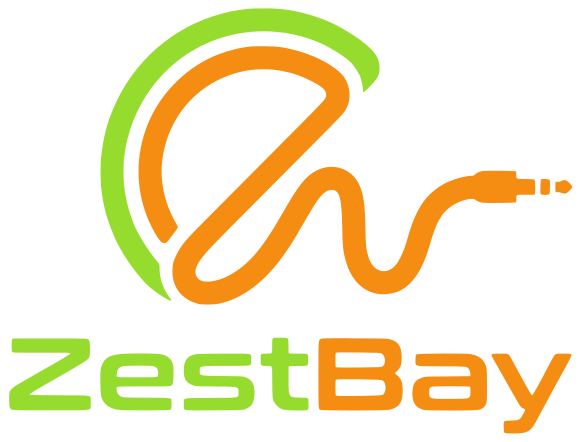
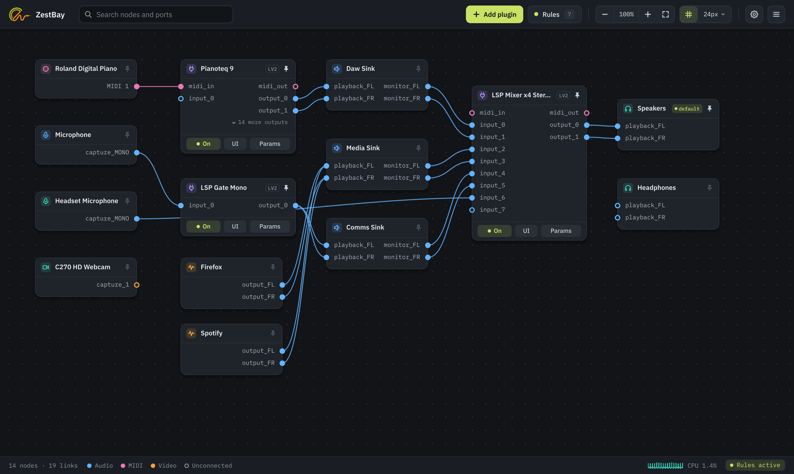
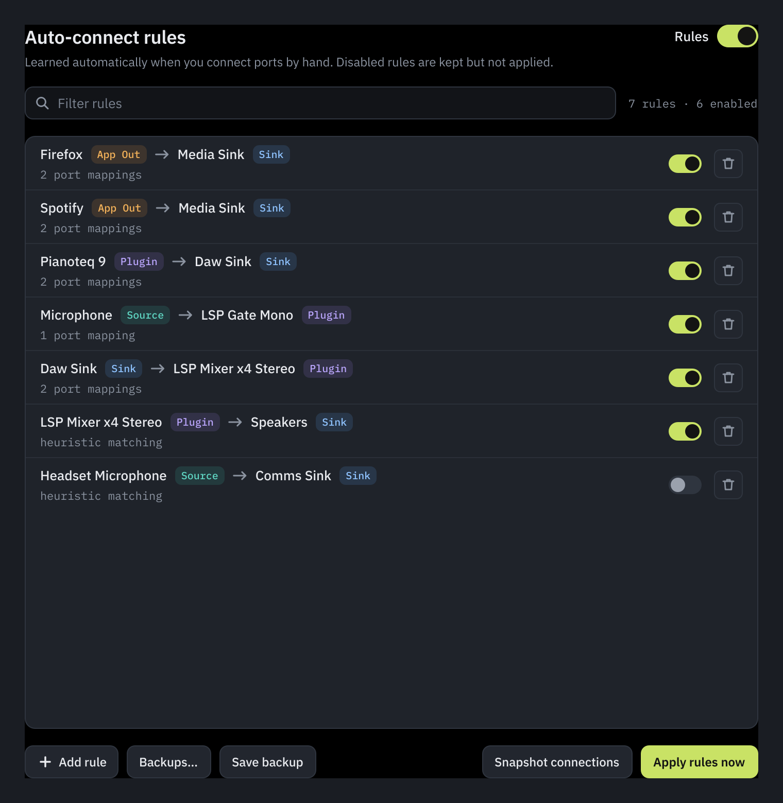
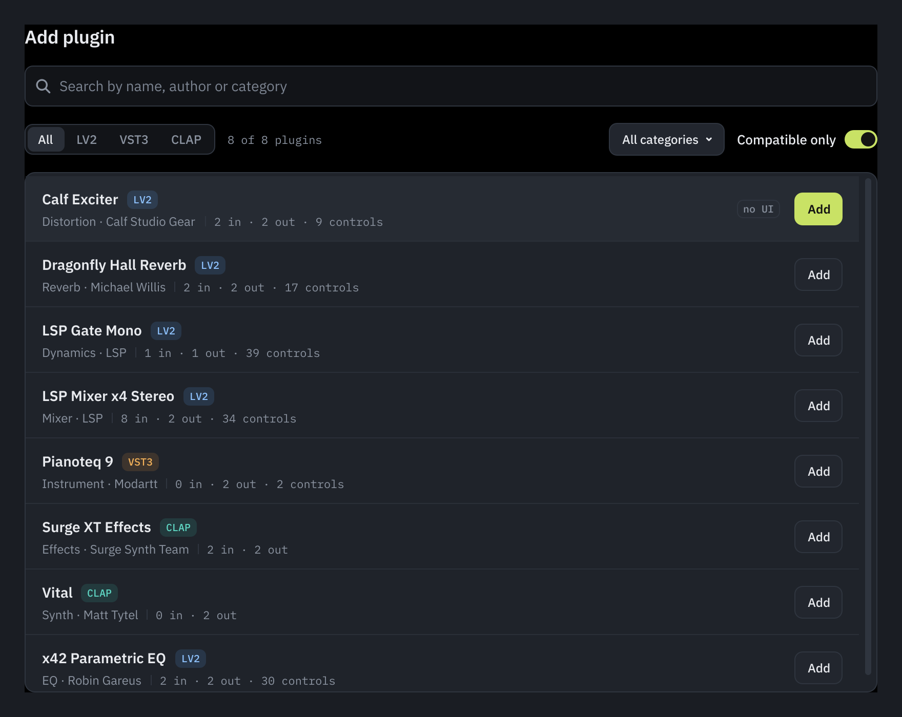
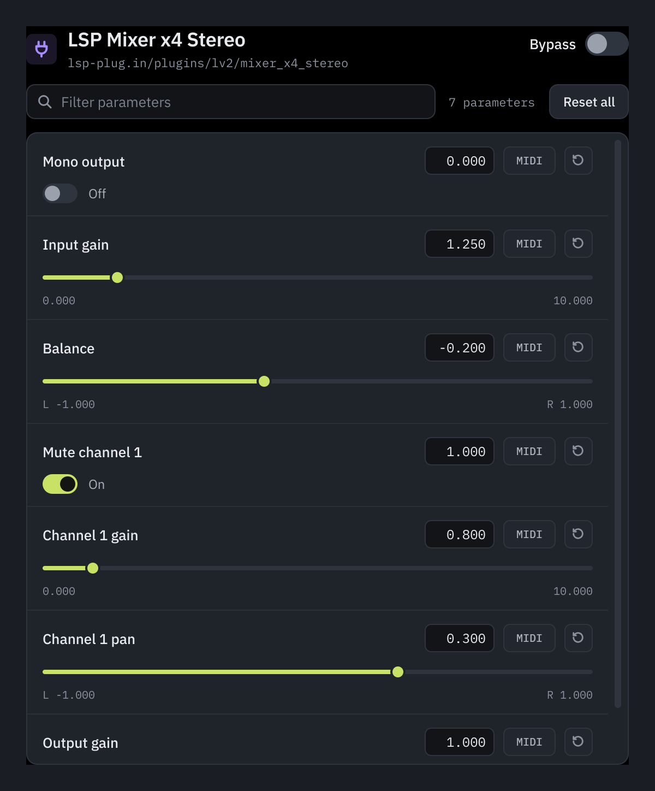
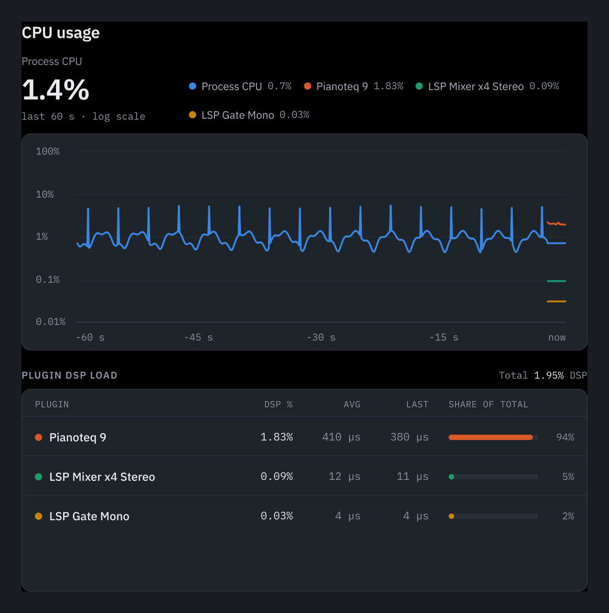
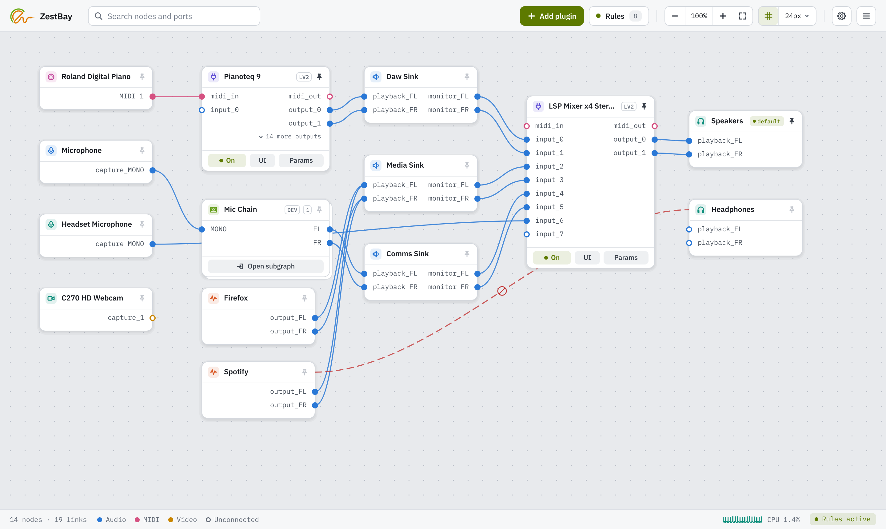

# ZestBay

<p align="center">
  
</p>

<p align="center">
  <strong>A PipeWire patchbay and audio routing manager with integrated LV2, VST3, and CLAP plugin hosting.</strong>
</p>

<p align="center">
  Built with Rust + Qt6/QML for a fast, native Linux desktop experience.
</p>

---

## What is ZestBay?

ZestBay is a visual audio routing tool for PipeWire on Linux. It lets you see every audio node in your system (applications, hardware devices, virtual sinks), connect and disconnect ports with drag-and-drop, host LV2, VST3, and CLAP effects plugins inline, define patchbay rules that automatically restore your routing (or keep things apart) whenever devices or apps appear, group plugin chains into reusable subgraphs, and create virtual devices.

## Screenshots

<p align="center">
  
</p>

<table>
  <tr>
    <td></td>
    <td></td>
  </tr>
  <tr>
    <td></td>
    <td></td>
  </tr>
</table>

<p align="center">
  
</p>

<sub>Screenshots are rendered from the real UI with sample data by
<code>design/screenshots/render.sh</code>.</sub>

## How it differs from other tools

### vs. qpwgraph

qpwgraph is a straightforward PipeWire graph editor. ZestBay goes further:

- **LV2, VST3, and CLAP plugin hosting** -- Insert effects (EQ, compressor, reverb, etc.) directly into the PipeWire graph without needing a DAW or separate plugin host. ZestBay creates real PipeWire filter nodes with RT-safe DSP processing. Comprehensive LV2 extension support (URID, worker, state, log, options, buf-size, data-access, instance-access) means most LV2 plugins load without issues. VST3 and CLAP plugins are hosted with full parameter, state, and native UI support.
- **Native plugin UIs** -- Open the original plugin interfaces. LV2 UIs (GTK3, X11, Qt5, GTK2, GTK4) via suil, VST3 and CLAP UIs via embedded X11 windows. A persistent GTK thread manages LV2 plugin windows without the crash-on-reopen issues common in LV2 hosts.
- **MIDI parameter control** -- Map hardware MIDI controllers to any plugin parameter with one-click learn. Continuous, toggle, and momentary modes with RT-safe processing.
- **Auto-connect rules with learning and blocking** -- Manually connect two ports and ZestBay creates a patchbay rule; disconnect them and the rule updates. Block rules keep a source from ever reaching a target.
- **Subgraphs and virtual devices** -- Group a plugin chain into one block, reuse it as a template, offer it to apps as a microphone or speaker, and create virtual sinks and sources without editing PipeWire config.
- **Full session persistence** -- Plugin instances, their parameters and state, bypass, wiring, MIDI mappings, subgraphs, virtual devices, layout, pins, viewport, window geometry, hidden nodes and rules all survive restarts.
- **System tray with start-minimized** -- Run ZestBay as a background service. It starts hidden, keeps your routing rules active, and shows the window when you click the tray icon.

### vs. Carla

Carla is a full-featured plugin host and JACK patchbay. The differences are about scope and integration:

- **PipeWire-native** -- ZestBay connects directly to PipeWire's native API, not through the JACK compatibility layer. Every PipeWire node (app streams, hardware devices, virtual sinks) appears naturally in the graph.
- **Lightweight and focused** -- ZestBay is a patchbay first. There is no transport, no MIDI sequencing, no rack view. It hosts LV2, VST3, and CLAP plugins for inline effects processing with MIDI CC/note learn for hands-on parameter control from hardware controllers. If you need a full DAW-style plugin host environment with MIDI tracks and transport, use Carla. If you need persistent audio routing with inline effects and hardware knob control, ZestBay is simpler and faster to set up.
- **No runtime dependencies beyond Qt6, PipeWire and the LV2 libraries** -- No Python. ZestBay ships its main binary and a small `zestbay-ui-bridge` helper that can run LV2 plugin UIs in a separate process.
- **Rust** -- Memory-safe core with lock-free DSP-to-UI communication. The RT audio callback uses raw pointers only where PipeWire's filter API requires it.

### vs. Helvum, PatchMatrix, and other GTK patchbays

- **LV2, VST3, and CLAP plugin hosting** -- Most PipeWire patchbays only visualize and connect. ZestBay can host plugins from all three major Linux plugin formats inline.
- **Auto-connect and block rules** -- Define patterns that automatically wire things up when nodes appear, or keep them apart. Other tools require manual reconnection every time.
- **Qt6/QML** -- Native look and feel on KDE Plasma and other Qt-based desktops, with dark and light themes that follow the desktop.

## Features

### Graph View
- Real-time PipeWire graph: devices, app streams, virtual sinks, plugins and subgraphs as node cards, colour-coded by kind; wires coloured by signal (audio, MIDI, video)
- MIDI bridge devices split into one node per device
- Drag from a port to another port to connect; select wires (click, Ctrl+click, selection box) and press Delete to disconnect
- Pan with middle-drag, zoom with the wheel (0.25x-3.0x), scroll bars, Fit to view (Home) and Reset zoom
- Drag nodes, alone or as a group; **snap to grid** (on by default, adjustable grid size) or Shift-drag to snap next to other nodes with a configurable gap
- **Pin** nodes so Auto layout never moves them; hide and unhide nodes
- Auto layout that follows the signal flow (and the grid)
- **Search** nodes and ports (Ctrl+F); non-matching nodes dim
- Plugins with many unused ports fold them into a "n more" row
- **Default node**: right-click a sink or plugin → Set as default; app streams without a rule are routed there
- Drag a plugin onto a wire to insert it into that connection
- Right-click menus for nodes, wires and the canvas
- Dark and light themes, or follow the desktop
- Status bar with node/link counts, a CPU sparkline and the rules state

### Plugin Hosting (LV2, VST3, CLAP)
- Browse, search, and filter all installed plugins by name, author, category, format or URI/ID; hide incompatible ones
- One-click instantiation as real PipeWire filter nodes with RT-safe audio processing
- 25 recognized plugin categories (Compressor, EQ, Reverb, Delay, etc.)
- Parameters window: sliders and toggles, per-parameter reset, MIDI learn
- **Manage plugins** window: every active plugin with its parameters, bypass state and Reset params
- Native plugin UI support:
  - **LV2**: GTK3, X11, Qt5, GTK2, GTK4 via suil; UIs that don't need direct access to the plugin instance can run in the separate `zestbay-ui-bridge` process
  - **VST3**: Embedded X11 windows with IPlugFrame resize support
  - **CLAP**: Embedded X11 windows with GUI resize and timer support
- Multiple simultaneous native plugin UIs
- Bypass toggle and rename per plugin instance
- Plugin state (parameters, bypass, LV2 state, VST3/CLAP state, connections) persisted across sessions
- **Crash protection**: each plugin is test-loaded in a separate process before it runs in ZestBay, so a crashing plugin is skipped instead of taking the app down. If a restore still crashes, the next start enters safe mode and offers the last known-good plugin set
- **CPU usage** window: per-plugin DSP load over time
- Optional "Let idle devices sleep" (passive effects) so a device linked only through plugins can suspend

### MIDI Parameter Control
- Map any MIDI CC or note message to any plugin parameter across all plugin formats (LV2, VST3, CLAP)
- **MIDI Learn**: click Learn on a parameter, move a knob or press a key on your controller, done
- Three mapping modes:
  - **Continuous**: CC 0-127 mapped linearly (or logarithmically for log-scale parameters) to the parameter range
  - **Toggle**: each press (CC > 63) flips the parameter between min and max
  - **Momentary**: parameter follows the controller state (on while held, off when released)
- Per-device mappings: bind different parameters to different MIDI controllers simultaneously
- Channel-specific or any-channel matching
- **MIDI mappings** window listing every mapping; conflicts are detected and can be reassigned
- RT-safe processing: MIDI is parsed and applied to parameter atomics directly in the PipeWire audio callback with no locks on the audio path
- Mappings persisted across sessions; mappings for an unplugged controller wait until it returns

### Supported LV2 Extensions
ZestBay provides a comprehensive set of LV2 host features, allowing it to load the vast majority of LV2 plugins:

| Extension | URI | Description |
|-----------|-----|-------------|
| URID Map | `http://lv2plug.in/ns/ext/urid#map` | Map URIs to integer IDs for RT-safe use |
| URID Unmap | `http://lv2plug.in/ns/ext/urid#unmap` | Reverse-map integer IDs back to URI strings |
| Worker | `http://lv2plug.in/ns/ext/worker#schedule` | Non-RT worker thread for heavy operations (file I/O, allocation) |
| State | `http://lv2plug.in/ns/ext/state#makePath` | Plugin state save and restore |
| Log | `http://lv2plug.in/ns/ext/log#log` | Structured logging with LV2 log levels routed to the host log system |
| Options | `http://lv2plug.in/ns/ext/options#options` | Expose host options (block length, sequence size, sample rate) to plugins |
| Buf-Size | `http://lv2plug.in/ns/ext/buf-size#boundedBlockLength` | Advertise bounded and fixed block length capabilities |
| Data Access | `http://lv2plug.in/ns/ext/data-access` | Provide plugin extension data to UIs |
| Instance Access | `http://lv2plug.in/ns/ext/instance-access` | Provide direct plugin instance handle to UIs |
| Resize Port | `http://lv2plug.in/ns/ext/resize-port#resize` | Port buffer resize requests (stub -- returns ERR_NO_SPACE) |
| URI Map | `http://lv2plug.in/ns/ext/uri-map` | Deprecated URI mapping for legacy plugin compatibility |

### Patchbay Rules
- **Auto-learn**: connect ports by hand and a rule is created; disconnect them and the rule is updated (can be turned off)
- Glob pattern matching for source and target node names (`*`, `?`), optionally limited to a node type
- Per-port-pair mappings with heuristic fallback (channel name, position)
- **Exclusive mode**: a source with rules is kept to exactly the connections its rules allow; turned off, rules only add links and never remove any
- **Block rules**: right-click a wire → Block this connection, select wires → Block selected links, or right-drag from one port to another. A blocked source never reaches the target: not by rules, the default node or by hand. Blocked pairs are drawn as red ⊘ lines; right-click one to remove the block
- Rules dialog: filter, enable/disable or delete each rule, add connect or block rules with quick-fill from existing node names
- **Backups**: save named backups of the rule set and restore them
- Snapshot current connections as a complete rule set
- Configurable settle time before rules are applied after graph changes
- Rules on/off and Exclusive mode from the menu and the tray; Apply rules now from the menu

### Subgraphs and Virtual Devices
- **Group** plugins into a subgraph (select them → right-click → Group into subgraph…) with a chosen number of inputs and outputs and optional MIDI; wires from outside are rerouted through it without dropping audio, and rules move with them
- **Open** a subgraph (button on its card, or double-click) to edit the plugins between its Input and Output nodes; Graph or Escape goes back
- **Edit** name, channels, MIDI and device options; **Ungroup** to turn it back into plain plugins; **Delete** removes it with its plugins
- **Show as a device**: the subgraph's input can be an output device apps play into, its output an input device apps record from (e.g. a "Mic Chain" microphone you pick in Discord)
- **Templates**: save a subgraph (plugins, settings, wiring, layout) and insert it again from Add plugin › Subgraphs, or Duplicate it
- **Virtual devices**: create virtual sinks and sources (like "Comms Sink") from the canvas menu instead of PipeWire config; edit or remove them from their node menu. They exist while ZestBay runs; a name another device already uses is skipped

### System Tray
- Start minimized (background service mode) and close to tray
- Left-click the tray icon to show or hide the window
- Tray menu: Show/Hide ZestBay, Plugin UIs (open any plugin's UI), Add plugin…, Patchbay rules…, Rules enabled and Exclusive mode toggles, Preferences…, Quit

### Keyboard Shortcuts

| Key | Action |
|-----|--------|
| Ctrl+F | Search nodes and ports |
| Home | Fit the graph to the view |
| Delete / Backspace | Disconnect the selected wires |
| Escape | Cancel a drag or placement, clear the selection, then leave a subgraph |
| Shift (while dragging) | Snap to nearby nodes (when snap to grid is off) |
| Ctrl+Q | Quit |

### Persistence
Everything is saved to `~/.config/zestbay/` (`~/.var/app/io.github.lemonxah.ZestBay/config/zestbay/` for the Flatpak) as JSON:

| File | Contents |
|------|----------|
| `preferences.json` | All user settings |
| `plugins.json` | Active plugin instances (LV2, VST3, CLAP) with parameters and state |
| `plugins.known_good.json` | Last plugin set that loaded cleanly (crash recovery) |
| `links.json` | Connections of plugins, subgraphs and virtual devices |
| `rules.json` | Patchbay connect and block rules |
| `rule_backups/` | Saved rule backups |
| `subgraphs.json` | Subgraphs: settings, member plugins, view |
| `subgraph_templates/` | Saved subgraph templates |
| `virtual_devices.json` | Virtual sinks and sources |
| `layout.json` | Node positions in the graph view |
| `pinned.json` | Pinned nodes |
| `hidden.json` | Hidden nodes |
| `default_node.txt` | The default node for unruled app streams |
| `viewport.json` | Pan and zoom state |
| `window.json` | Window position and size |
| `midi_mappings.json` | MIDI CC/note-to-parameter mappings |

Subgraph and virtual device files from older versions are upgraded when ZestBay starts (the original is kept as `<file>.pre-upgrade`); a config file that can't be read is kept as `<file>.corrupt-<date>` and reported.

## Installation

- **Arch Linux**: ZestBay is in the official Arch Linux `extra` repository:
  `sudo pacman -S zestbay`. It is no longer on the AUR; if you installed the
  AUR package before, the `extra` package replaces it. The `pkg/zestbay/` and
  `pkg/zestbay-git/` PKGBUILDs in this repo are only for building a tagged
  release or the latest commit yourself.
- **Flatpak**: `io.github.lemonxah.ZestBay` -- see [`pkg/flatpak/README.md`](pkg/flatpak/README.md) to build it locally or make a single-file bundle (`just flatpak`, `just flatpak-bundle`).
- **Fedora/RPM, Debian, Nix**: packaging in `pkg/rpm/`, `pkg/deb/` and `pkg/nix/`.
- **From source**: see below; `just install` builds and installs to `/usr`.

## Building from source

### Dependencies

**Runtime:**
- PipeWire
- Qt6 (Base, Declarative)
- lilv, LV2, suil
- libX11
- D-Bus

**Build:**
- Rust (stable toolchain)
- Cargo
- Clang
- CMake
- pkg-config
- Qt6 development headers

### Build

```sh
cargo build --release
```

The binaries are at `target/release/zestbay` and `target/release/zestbay-ui-bridge`.

### Run

```sh
./target/release/zestbay
```

Or from the project root (for development, so the tray icon theme path resolves):

```sh
cargo run --release
```

Command-line options:

| Option | Effect |
|--------|--------|
| `--safe-mode` | Start without restoring saved plugins (they stay in `plugins.json`) |
| `--no-probe` | Skip the crash-protection test load of plugins (faster, but a crashing plugin takes ZestBay down) |

`RUST_LOG=debug zestbay` shows detailed logs.

## Installing plugins

ZestBay scans for LV2, VST3 and CLAP plugins when it starts, so restart it
after adding plugins. Where plugins go depends on which version you run
(**About** shows *Install: Native* or *Install: Flatpak*).

### Native version (distro package or built from source)

The native version sees every plugin installed on your system.

- **Plugins from your distro** (e.g. `pacman -S lsp-plugins x42-plugins`) go
  to the system folders and are found automatically.
- **Paid or custom plugins** (Pianoteq, commercial VST3s, your own builds): put
  the plugin bundle in your home folder, or install it system-wide with the
  vendor's installer.

| Format | Your plugins | System-wide |
|---|---|---|
| LV2 | `~/.lv2/` | `/usr/lib/lv2/`, `/usr/local/lib/lv2/` |
| VST3 | `~/.vst3/` | `/usr/lib/vst3/`, `/usr/local/lib/vst3/`, `/usr/lib64/vst3/` |
| CLAP | `~/.clap/` | `/usr/lib/clap/`, `/usr/local/lib/clap/`, `/usr/lib64/clap/` |

Other folders can be added with `VST3_PATH` / `CLAP_PATH` (colon-separated,
searched first). `LV2_PATH` *replaces* the LV2 search path, so include the
defaults you still want:

```sh
LV2_PATH="$HOME/.lv2:/usr/lib/lv2:/opt/my-plugins/lv2" zestbay
```

### Flatpak version

The Flatpak runs in a sandbox: it can't see `/usr/lib/lv2` or your home
folder, only plugins packaged for Flatpak and its own plugin folder.

**Free plugins: install them from Flathub.** Most free Linux plugins are
packaged as Flatpak extensions (LSP, x42, Calf, Dragonfly Reverb, Surge XT,
Guitarix, ZamPlugins, sfizz, Cardinal and many more):

```sh
flatpak search LinuxAudio.Plugins
flatpak install flathub org.freedesktop.LinuxAudio.Plugins.LSP//25.08
```

The `//25.08` branch must match the runtime ZestBay uses; plugins on another
branch won't show up.

**Paid and custom plugins: copy them into ZestBay's plugin folder.** Plugins
that aren't on Flathub (Pianoteq, commercial plugins, your own builds) go in:

```
~/.var/app/io.github.lemonxah.ZestBay/data/lv2/
~/.var/app/io.github.lemonxah.ZestBay/data/vst3/
~/.var/app/io.github.lemonxah.ZestBay/data/clap/
```

ZestBay creates these folders on first start, and **Add plugin** shows the
location with an **Open folder** button. Copy the bundles; don't symlink
them, a link into `/usr` points outside the sandbox and won't load.

Example, Pianoteq 9 (from the Modartt download, or from an existing
native install):

```sh
cp -r "/usr/lib/lv2/Pianoteq 9.lv2"   ~/.var/app/io.github.lemonxah.ZestBay/data/lv2/
cp -r "/usr/lib/vst3/Pianoteq 9.vst3" ~/.var/app/io.github.lemonxah.ZestBay/data/vst3/
```

Then restart ZestBay. Plugins keep their own settings and licences inside the
Flatpak (`~/.var/app/io.github.lemonxah.ZestBay/`), separate from the native
version, so a licensed plugin may ask to be activated once more: open its UI
from ZestBay and activate it there (the Flatpak has network access for this).

Plugins built against your distro's libraries may not load inside the
Flatpak runtime; ZestBay tests each plugin in a separate process first and
skips one that fails, so it can't crash the app. Use the Flathub package of
that plugin, or the native version of ZestBay, instead.

**Optional: let the Flatpak see more.** These are per-user overrides, not
needed for the setups above:

```sh
# Your ~/.lv2, ~/.vst3 and ~/.clap folders
flatpak override --user --filesystem=~/.lv2 --filesystem=~/.vst3 --filesystem=~/.clap io.github.lemonxah.ZestBay
# The system plugin folders (/usr/lib/lv2 …), read-only
flatpak override --user --filesystem=host-os:ro io.github.lemonxah.ZestBay
# Undo
flatpak override --user --reset io.github.lemonxah.ZestBay
```

The Flatpak also keeps its own ZestBay settings (rules, layout, plugins) in
`~/.var/app/io.github.lemonxah.ZestBay/config/zestbay`, separate from the
native version's `~/.config/zestbay`.

## Architecture

ZestBay uses a multi-threaded architecture with clean separation between components:

- The **Qt/QML thread** runs the UI and polls for events at a configurable interval
- The **PipeWire thread** owns the graph state, processes audio in RT callbacks, and handles all PipeWire API calls
- The **tray thread** runs the D-Bus StatusNotifier service independently
- The **GTK thread** manages native LV2 plugin UI windows
- The **`zestbay-ui-bridge` process** hosts LV2 UIs that can run out of process, and short-lived **probe processes** test-load plugins so a crashing plugin can't take ZestBay down
- **Subgraph edges** and **virtual devices** are PipeWire nodes ZestBay owns: pass-through filters and in-process loopback modules
- Communication uses typed channels (`mpsc`) and lock-free atomics -- no mutexes on the audio path

## License

[MIT](LICENSE)
